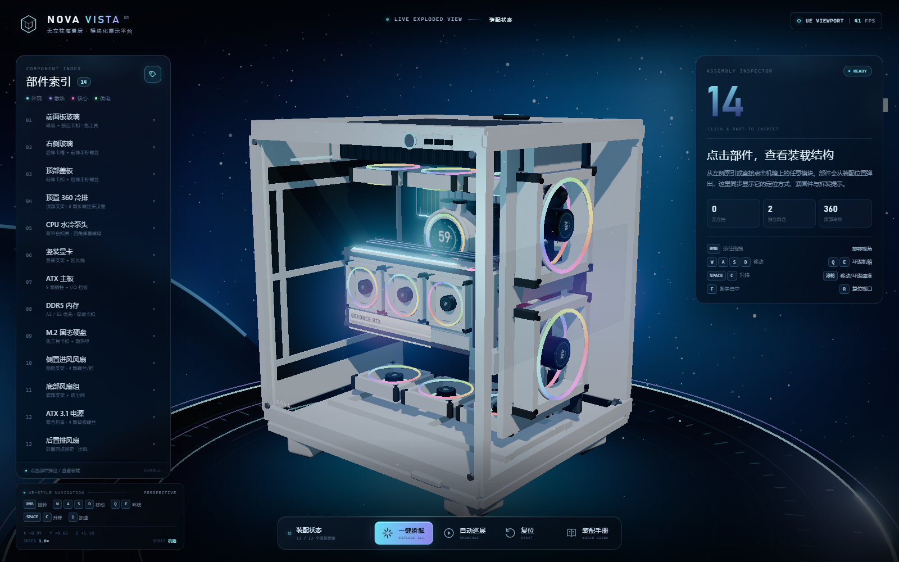
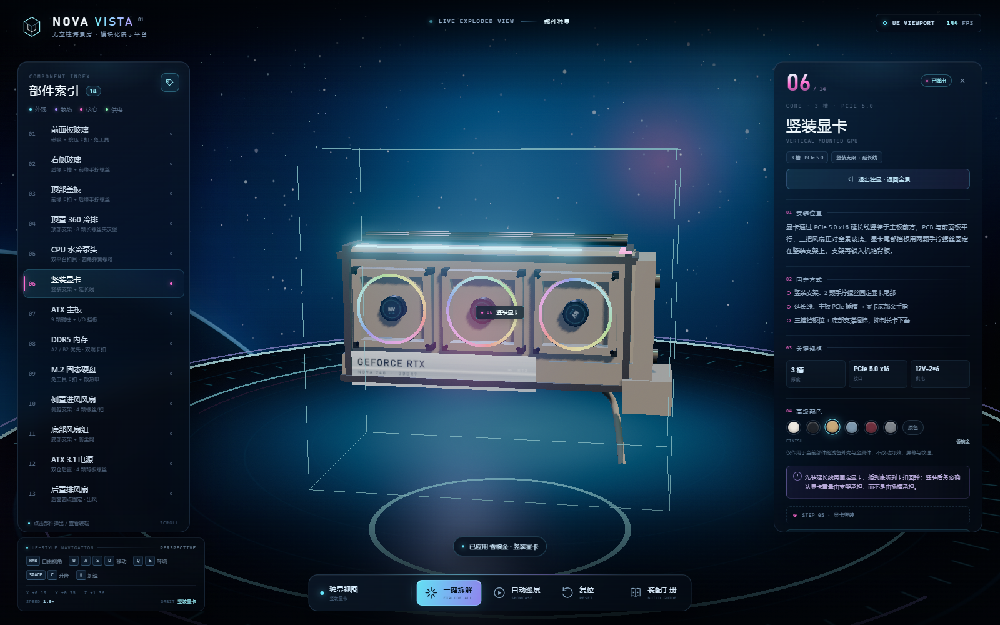
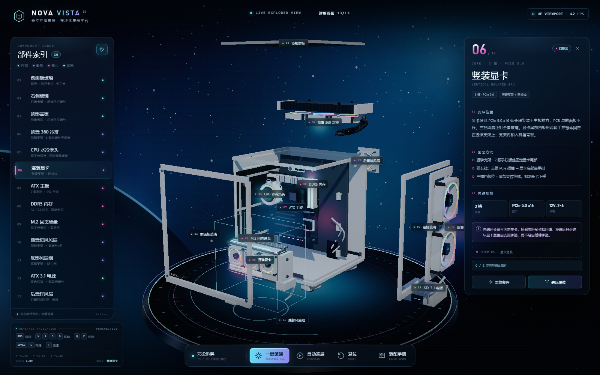
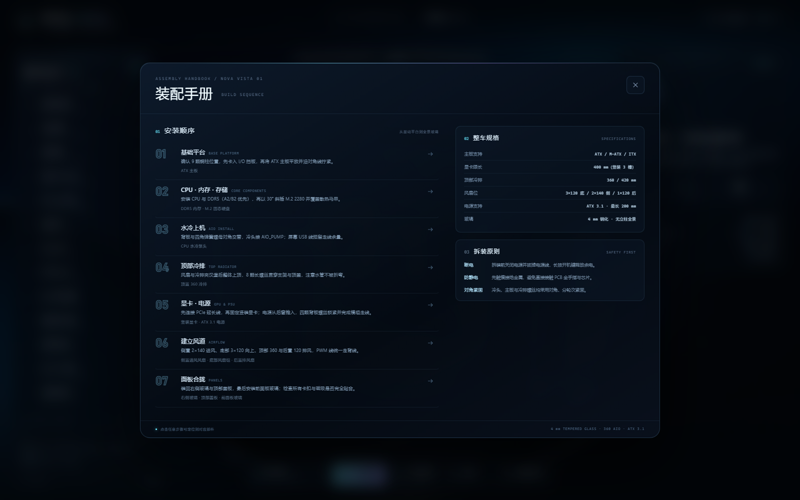
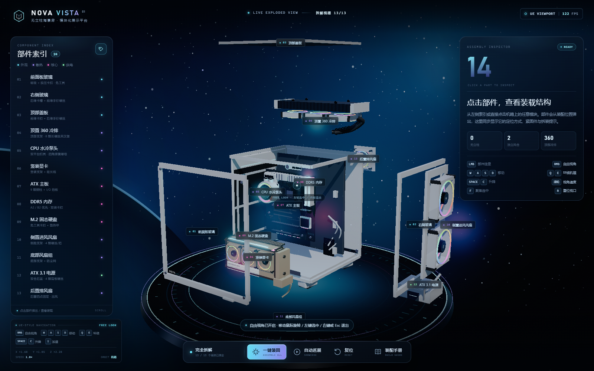
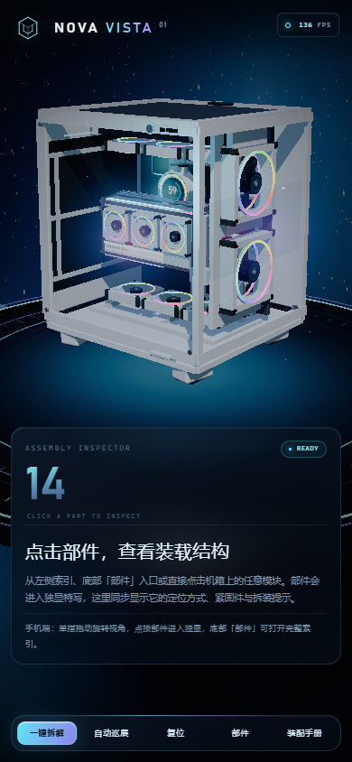
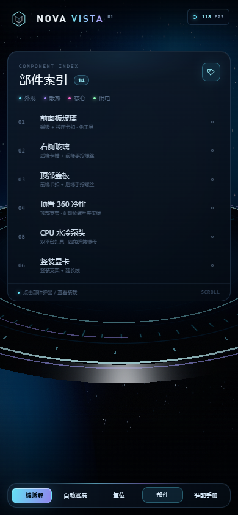

# NOVA VISTA · 3D 可拆解海景房机箱

一个纯前端、可离线运行的 3D 机箱拆解展示。模型完全由代码程序化生成，没有外部模型或贴图文件；包含 UE 风格自由视角、逐件弹出、自动巡展、部件标注与七步装配手册。

**在线访问：** https://parader-ling.github.io/nova-vista-3d/  
**GitHub 仓库：** https://github.com/Parader-ling/nova-vista-3d

> GitHub Pages 为公开站点，使用任意电脑/手机的现代浏览器打开即可，不需要安装任何环境。



## 快速开始

**方式一：直接打开（推荐）**

双击 `NOVA-VISTA-3D.html`，或双击 `启动演示.cmd`。这是单文件版本，Three.js 与全部资源已内联，不需要联网、不需要装环境。

**方式二：本地开发服务器**

```bat
npm install
npm run dev
```

浏览器打开 `http://127.0.0.1:4173/`。

**方式三：重新打包单文件**

```bat
npm run build
```

产物在 `dist/index.html`，可直接复制到任意位置双击打开。

> 需要支持 WebGL 2 的现代浏览器（Chrome / Edge / Firefox / Safari 新版）。如果页面一直停在载入界面，请开启浏览器硬件加速。

## 操作说明

| 操作 | 功能 |
| --- | --- |
| 左键点击部件 | 进入**部件独显**：其他部件隐藏，镜头自动贴近并居中，右侧显示装载说明与配色 |
| 左键点击空白 | 退出独显 / 取消选择 |
| 单击右键 | **进入 / 退出自由视角**（不需要按住） |
| 自由视角内移动鼠标 | 旋转视线，镜头保持平滑阻尼 |
| 自由视角内左键 | 选择屏幕中心准星对准的部件 |
| 自由视角内右键 / `Esc` | 退出自由视角 |
| `W` `A` `S` `D` | 前后左右移动 |
| `Q` / `E` | 围绕机箱水平环绕；独显时自动改为围绕当前部件旋转 |
| `Space` / `C` | 上升 / 下降（也支持 PageUp / PageDown） |
| `Shift` | 加速移动与加速环绕 |
| 滚轮 | 调整移动与旋转速度（0.3×–3.0×，左下角 HUD 实时显示） |
| `F` | 重新居中当前部件 |
| `R` | 复位视角与装配状态 |
| `L` | 显示 / 隐藏标注 |
| `Esc` | 退出自由视角 / 独显，或关闭装配手册 |

> 手机端：单指拖动旋转视角，点按部件进入独显；底部「部件」按钮打开完整 14 个模块索引。横屏时默认显示全屏 3D 视口，选中部件后右侧显示说明。

底部按钮：

- **一键拆解 / 一键装回**：13 个可动模块依次弹出，镜头自动退到拆解视图。
- **自动巡展**：镜头环绕机箱、逐件拆解，并自动轮播关键部件的装载说明；单击右键或 WASD 可随时接管。
- **复位**：收回所有部件并回到默认视角。
- **装配手册**：查看七步总装顺序、整车规格与拆装原则；点击任一步骤可定位对应部件。

## 每个部件怎么装

| # | 部件 | 安装位置 | 固定方式 |
| --- | --- | --- | --- |
| 01 | 前面板玻璃 | 机箱正面，嵌入上下白色边框 | 下缘 U 型槽 + 上缘按压卡扣 + 4 颗磁吸定位柱，免工具 |
| 02 | 右侧玻璃 | 机箱右侧，后缘先入内胆卡槽 | 前缘 2 组磁吸 + 1 颗防丢手拧螺丝，内侧减震胶条 |
| 03 | 顶部盖板 | 顶部 360 冷排位上方 | 前缘 2 处插舌 + 后缘 2 颗手拧螺丝，内侧磁吸防尘网 |
| 04 | 顶置 360 冷排 | 顶部支架下方，风扇位于冷排与顶盖之间 | 4 颗 M3×30 长螺丝从外侧贯穿支架、风扇锁入冷排；风扇 12 颗短螺丝 |
| 05 | CPU 水冷泵头 | CPU 插槽正上方 | LGA1700 / AM5 双平台扣具，四角弹簧螺母对角分 2–3 轮紧固 |
| 06 | 竖装显卡 | 主板前方，PCB 与前面板平行 | PCIe 5.0 x16 延长线 + 竖装支架，尾部 2 颗手拧螺丝，三槽挡板位 |
| 07 | ATX 主板 | 白色内胆托盘的 9 颗铜柱上 | 9 颗 M3 螺丝对角紧固，I/O 挡板先卡入后窗 |
| 08 | DDR5 内存 | 主板 A2 / B2 插槽（第 2、4 槽） | 防呆缺口对准后两端同时下压，卡扣自动锁止 |
| 09 | M.2 固态硬盘 | M.2_1 2280 插槽，CPU 下方 | 30° 斜插金手指，免工具旋转卡扣 + 白色散热马甲 |
| 10 | 侧置进风风扇 | 右侧进风支架，2×140 mm | 每把 4 颗螺丝，进风面朝外，磁吸防尘网 |
| 11 | 底部风扇组 | 底仓支架，3×120 mm，向上送风 | 每把 4 颗螺丝，底部抽拉防尘网 |
| 12 | ATX 3.1 电源 | 主板托盘后方独立双仓 | 后面板 4 颗螺丝，风扇朝下，24-pin / 12V-2×6 全走背线 |
| 13 | 后置排风扇 | 后窗 120 mm 风扇位 | 4 颗螺丝从外部锁入，出风朝后，与顶部冷排形成负压 |
| 14 | 承力内胆框架 | 全机基准结构 | 1.0 mm SPCC 折弯 + 铆接，主板托盘、冷排支架、电源仓均固定于此，不建议拆解 |

应用内点击每个部件还能看到更细的「安装位置 / 固定方式 / 关键规格 / 拆装提示」，并标明它在总装中的步骤。

## 已实现的功能

- **3D 机箱模型**：白色无立柱海景房，双仓结构，前面板 + 右侧双全景视窗。
- **14 个可交互模块**：玻璃、面板、冷排、泵头、显卡、主板、内存、M.2、侧/底/后风扇、电源、框架。
- **部件独显**：左键点击任意部件，其他 13 个模块自动隐藏，镜头平滑推进到部件特写并居中；独显中的部件会轻微悬浮、缓慢摆头，像展示台上的实物，不再像静态截图。装载说明在右侧，底部显示 `独显视图`。通过顶部「退出独显」、信息卡 X、`Esc` 或点击空白返回全景。
- **高级配色**：独显时可给当前部件换色，内置云母白、曜石黑、香槟金、冰川蓝、勃艮第红、钛灰 6 组低饱和高级色，并支持一键恢复原厂色。改色只影响当前部件的浅色外壳/金属件，保留纹理、灯效和屏幕。
- **单击右键自由视角**：单击右键进入 UE 风格自由视角并锁定鼠标，移动鼠标直接旋转，WASD/QE 移动环绕，左键以准星选取部件；再次右键或 `Esc` 退出，无需长按。
- **一键拆解 / 一键装回**：全模块以更大的行程错峰弹出，镜头自动切换到适配拆解范围的视角。
- **相机平滑插值**：鼠标旋转、WASD 位移、Q/E 环绕、聚焦与拆解镜头全部带阻尼/缓动；已调快阻尼，拖拽/起停基本没有延迟感。
- **滚轮调速**：滚轮不再推拉镜头，而是同步调整鼠标旋转、WASD 位移与 Q/E 环绕速度；左下角 HUD 显示当前倍率与环绕中心。
- **动态环绕中心**：默认围绕机箱中心旋转；独显时 Q/E 自动以该部件为轴心，HUD 的 `ORBIT` 会显示当前轴心。
- **UE 风格视口**：单击右键进入自由视角，WASD 移动，Q/E 环绕，Space/C 升降，Shift 加速，滚轮调速，F 聚焦，R 复位；实时显示 FPS 与相机坐标。
- **自动巡展**：摄像机缓慢环绕，自动展开全部模块并轮播关键部件说明，支持随时接管。
- **部件标注**：所有部件在弹出后显示漂浮标签，可一键隐藏。
- **装载信息面板**：每个部件都有安装位置、固定方式、规格、拆装提示与装配步骤。
- **装配手册**：七步总装流程、整车规格、拆装原则，支持点击步骤直接定位部件。
- **手机端视角适配**：竖屏时相机投影自动上移，机箱完整落在底部信息卡上方；底部新增「部件」抽屉；单指拖动旋转视角，点按部件进入独显。
- **横屏适配**：手机横屏时默认隐藏信息卡，保留完整 3D 视口；选中部件后信息卡从右侧滑出，避免遮住机箱。
- **渐变展示背景**：深空蓝紫渐变、星点、行星地平线、发光展示台、漂浮粒子。
- **响应式布局**：桌面端为左右信息面板 + 底部控制栏；平板竖屏使用移动端底部卡片；手机竖屏自动上移构图并收起部件索引。

## 截图

| | |
| --- | --- |
|  |  |
| 部件独显 · 香槟金配色与装载说明 | 一键拆解视图（13 个模块） |
|  |  |
| 七步装配手册 | 单击右键进入自由视角（中心准星） |
|  |  |
| 竖屏构图：机箱自动避开底部信息卡 | 底部「部件」抽屉，可切换全部模块 |

## 项目结构

```
nova-vista-3d/
├─ index.html                 开发入口 / 完整 UI 结构
├─ src/
│  ├─ main.js                 场景、灯光、相机、交互、动画、UI 逻辑
│  ├─ style.css               UI 与响应式视觉
│  └─ lib/
│     ├─ buildCase.js         程序化 3D 机箱与 14 个部件
│     ├─ partData.js          部件装载数据、装配步骤、规格
│     └─ textures.js          PCB / LCD / RGB / 环境 / 背景等 Canvas 纹理
├─ screenshots/               效果截图
├─ docs/
│  ├─ index.html              GitHub Pages 入口（构建后的单文件）
│  └─ .nojekyll               禁用 Jekyll 处理
├─ NOVA-VISTA-3D.html        单文件离线版（交付物）
├─ 启动演示.cmd              双击打开单文件演示
├─ vite.config.js             Vite + 单文件内联配置
├─ package.json
└─ README.md
```

### 更新线上版本

```bat
npm run build
copy /Y dist\index.html docs\index.html
git add docs\index.html
git commit -m "deploy: update showcase"
git push
```

GitHub Pages 会自动重新构建 `docs` 目录。

## 实现说明

- **Three.js r186** + Vite 构建；运行时无任何 CDN 依赖。
- 机箱、风扇、冷排、主板、PCB、水冷屏、RGB 灯环、展示台等均为程序化几何与 Canvas 纹理生成。
- 使用自定义 studio 环境贴图提供反射；AgX tone mapping + 轻量 bloom 保持白色机箱不过曝。
- 相机不是 OrbitControls，而是按 UE 视口习惯实现的自由飞行 rig：RMB 偏航/俯仰 + WASD 世界移动 + Q/E 轨道环绕（未选中部件时机身为轴心，选中并弹出部件后自动切换到该部件）+ Space/C 升降 + F 聚焦插值；滚轮只调速度，不改变构图。
- 相机姿态使用目标角 + 阻尼插值：鼠标写入目标偏航/俯仰，渲染循环用指数缓动逼近；轨道环绕使用平滑角速度，WASD 使用速度阻尼；镜头飞行、聚焦与拆解视角使用 smoothstep 位置/注视点插值。
- 独显模式保存进入前的相机位姿，隐藏其他 13 个部件，并把镜头插值到当前部件包围盒中心；退出时恢复相机与全部部件。
- 部件配色通过按部件克隆浅色外壳/金属件材质实现，不会污染其他部件；恢复原色时还原原始材质。
- 自由视角优先使用 Pointer Lock 锁定鼠标（便于无限旋转），若浏览器拒绝则自动退化为视口内鼠标移动旋转；左键在锁定状态下以屏幕中心准星选取。
- 手机竖屏通过 `camera.setViewOffset()` 把画面整体上移约 21% 视口高度，适配底部信息卡与操作栏；横屏/桌面自动清除偏移。
- 手机底部「部件」抽屉复用桌面端部件索引，打开时隐藏信息卡，选中部件后自动关闭并进入独显。
- 部件拆解状态是独立的目标值，渲染循环用阻尼插值驱动；因此单件弹出、全部拆解、自动巡展和复位可以互相切换而不冲突。
- 单文件版本通过 `vite-plugin-singlefile` 将 JS、CSS、Three.js 与纹理生成逻辑全部内联。

## 备注

- 造型与色彩参考了用户提供的白色无立柱海景房照片，但模型为原创程序化重建，并非直接使用图片贴图。
- 显卡、主板等为展示用简化模型，尺寸与接口位置按视觉比例设计；真实装机请以具体硬件手册为准。
- 当前单文件约 903 KB（gzip 约 241 KB），可直接离线分发。
